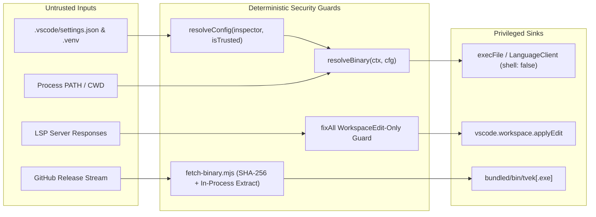
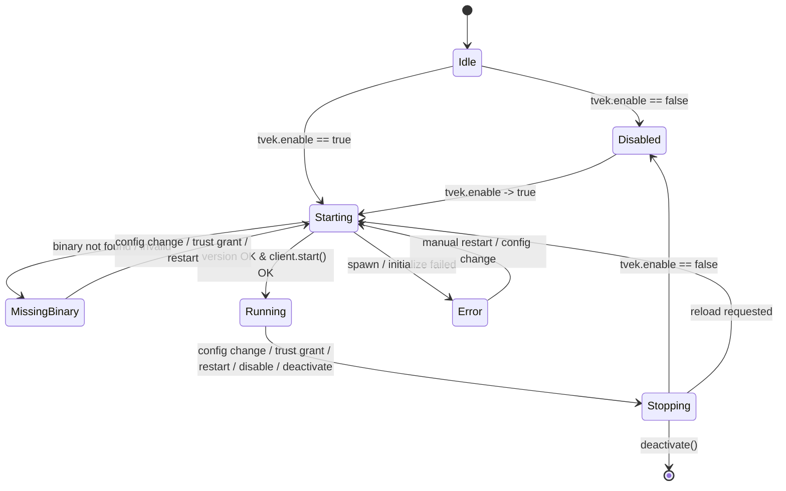

# ADR 0001: `tvek-vscode` System Architecture, Lifecycle State Machine, and Workspace Trust Model

- **Status**: Accepted
- **Date**: 2026-11-26
- **Deciders**: `@architect`

---

## 1. Context & Goals

`tvek-vscode` is a standalone, production-grade Visual Studio Code extension for [`tvek`](https://github.com/Xpt0xZv/tvek), a Rust RFC 8259 JSON/JSONC linter, formatter, and built-in LSP 3.17 server (`tvek server [--max-size <BYTES>]` over `stdio`).

### Architectural Goals
1. **Defense-in-Depth RCE Prevention**: Eliminate untrusted workspace binary/setting hijacking, Windows CWD/PATH DLL/EXE planting, shell command injection, LSP command-execution gadgets, and supply-chain archive tampering (`SHA256SUMS` pre-extraction verification + path-traversal-proof extraction).
2. **Pure-Node Testability**: Decouple domain logic (configuration resolution, Workspace Trust filtering, binary discovery, version parsing, and lifecycle mutex coordination) from the `vscode` runtime module so fast, deterministic unit tests execute directly in Node.js (`node:test`) without booting the Electron Extension Host.
3. **Race-Free Lifecycle Management**: Upstream `tvek server` parses options exclusively during LSP `initialize` and intentionally returns `-32601 MethodNotFound` for `workspace/didChangeConfiguration`. Every `tvek.*` configuration mutation, Workspace Trust grant, or manual restart must cleanly stop and restart `LanguageClient` through a serialized state machine with zero orphan child processes.
4. **Minimal Footprint & Zero Telemetry**: Bundle into a single CommonJS entrypoint (`dist/extension.js`) via `esbuild` with `vscode-languageclient` (`^9.0.1`) as the sole runtime dependency, zero custom webviews, and zero runtime network traffic.

### Explicit Non-Goals
- Virtual filesystems (`vscode-vfs://`, `github://`): `capabilities.virtualWorkspaces` is `{ supported: false }`; document selectors bind strictly to `file` and `untitled` URI schemes for `json` and `jsonc`.
- Custom AST parsing or duplicate formatting logic in TypeScript: `tvek` is the single source of truth for diagnostics, formatting, and code actions.

---

## 2. Proposed Module Layout & Interfaces

Modules are partitioned across a strict **Pure Node Boundary** (`zero` imports of `'vscode'`) and a thin **VS Code Host Adapter Layer**:

```text
tvek-vscode/
├── scripts/
│   ├── build.mjs                 # esbuild CJS bundler (dist/extension.js)
│   └── fetch-binary.mjs          # Zero-dep HTTPS + SHA-256 + safe tar.gz/zip fetcher
├── src/
│   ├── types.ts                  # Pure TS contracts, discriminated unions & constants
│   ├── config.ts                 # Pure config normalization, clamping & trust filtering
│   ├── binary.ts                 # Pure Node binary resolution, PATH hygiene & --version probe
│   ├── mutex.ts                  # Pure FIFO AsyncMutex & coalescing reload scheduler
│   ├── client.ts                 # vscode-languageclient lifecycle state machine
│   ├── status.ts                 # vscode.LanguageStatusItem presenter (json + jsonc)
│   ├── commands.ts               # tvek.restartServer, tvek.fixAll, tvek.showLogs
│   └── extension.ts              # activate() / deactivate() composition root
└── test/
    ├── unit/                     # Runs directly via `node --test` (no Electron host)
    ├── e2e/                      # Runs via `@vscode/test-cli` in Extension Host
    └── fixtures/
        └── mock-tvek-lsp.mjs     # Zero-dep RFC-compliant stdio JSON-RPC 2.0 LSP 3.17 mock
```

### Pure Node Interfaces (`src/types.ts`, `src/config.ts`, `src/binary.ts`, `src/mutex.ts`)

```ts
export type BinarySource = 'custom' | 'bundled' | 'venv' | 'path';
export type ImportStrategy = 'useBundled' | 'fromEnvironment';
export type TraceLevel = 'off' | 'messages' | 'verbose';

/** Upstream `tvek server` LSP `initializeParams.initializationOptions` payload. */
export interface TvekInitializationOptions {
  readonly sortKeys: boolean;
  readonly minify: boolean;
  readonly allowComments: boolean;
  readonly strict: boolean;
  readonly structural: boolean;
  readonly lineWidth: number;   // Integer in 0..=4096; forced to 0 when structural === true
  readonly maxSize: number;     // Integer in 1..=104_857_600 (100 MiB)
}

export interface ResolvedConfig {
  readonly enable: boolean;
  readonly path: string | null; // Always null when isTrusted === false
  readonly importStrategy: ImportStrategy; // Always 'useBundled' when isTrusted === false
  readonly traceServer: TraceLevel;
  readonly initOptions: TvekInitializationOptions;
}

/** Abstracts vscode.WorkspaceConfiguration.inspect<T>() for pure Node testing. */
export interface InspectedSetting<T> {
  readonly defaultValue?: T;
  readonly globalValue?: T;
  readonly workspaceValue?: T;
  readonly workspaceFolderValue?: T;
}
export type SettingInspector = <T>(key: string) => InspectedSetting<T> | undefined;

export interface BinaryResolutionContext {
  readonly platform: NodeJS.Platform;
  readonly env: NodeJS.ProcessEnv;
  readonly extensionPath: string;
  readonly workspaceFolders: readonly string[]; // Absolute filesystem paths
  readonly isTrusted: boolean;
}

export interface ResolvedBinary {
  readonly command: string;     // Canonical verified absolute path to executable
  readonly source: BinarySource;
  readonly version: string;     // SemVer parsed from `tvek --version`
  readonly safeCwd: string;     // Always extensionPath (never a workspace folder)
  readonly safeEnv: NodeJS.ProcessEnv;
}
```

### Configuration Coercion & Invariants (`src/config.ts`)
1. **Trust-Gated Inspection**:
   - When `isTrusted === true`: effective value is `workspaceFolderValue ?? workspaceValue ?? globalValue ?? defaultValue ?? FALLBACK`.
   - When `isTrusted === false`: `.vscode/settings.json` and `.code-workspace` values are ignored unconditionally (`globalValue ?? defaultValue ?? FALLBACK`). Furthermore, `path` is hard-forced to `null` and `importStrategy` is hard-forced to `'useBundled'`.
2. **Upstream Option Clamping**:
   - `lineWidth`: truncated integer clamped to `[0, 4096]` (default `80`); forced to `0` whenever `structural === true`.
   - `allowComments`: boolean (default `false`); forced to `false` whenever `strict === true`.
   - `maxSize`: truncated integer clamped to `[1, 104_857_600]` (default `104_857_600`); `NaN` / non-finite values fall back to `104_857_600`.

---

## 3. Trust Boundaries, RCE Threat Model & Binary Verification Invariants



### 3.1 Workspace Trust & Binary Discovery Order (`src/binary.ts`)
`package.json` declares:
```json
"capabilities": {
  "untrustedWorkspaces": {
    "supported": "limited",
    "restrictedConfigurations": ["tvek.path", "tvek.importStrategy"]
  },
  "virtualWorkspaces": { "supported": false }
}
```

| Mode | Ordered Search Candidates | Security Enforcement |
| :--- | :--- | :--- |
| **Trusted** (`isTrusted === true`) + `tvek.path` non-empty | 1. `tvek.path` ONLY (fail closed if missing/invalid—do not silently fall back when user explicitly pinned a binary) | Resolve relative paths against first workspace folder; verify regular file + executable bit; resolve `realpath`. |
| **Trusted** + `useBundled` (default) | 1. `<extensionPath>/bundled/bin/tvek[.exe]`<br>2. `<wsFolder>/.venv/{Scripts/tvek.exe \| bin/tvek}`<br>3. Sanitized `PATH` | Reject empty/relative `PATH` entries; verify regular file (`stat.isFile()`). |
| **Trusted** + `fromEnvironment` | 1. `<wsFolder>/.venv/{Scripts/tvek.exe \| bin/tvek}`<br>2. Sanitized `PATH`<br>3. `<extensionPath>/bundled/bin/tvek[.exe]` | Same as above. |
| **Untrusted** (`isTrusted === false`) | 1. `<extensionPath>/bundled/bin/tvek[.exe]`<br>2. Trusted system `PATH` ONLY (if bundled absent) | Ignore `tvek.path`, ignore `.venv`, strip all empty/relative/`CWD` entries from `PATH`, and strip any `PATH` directory (or `realpath` target of candidate binary!) residing inside any `workspaceFolder`. |

### 3.2 Subprocess & Windows CWD/PATH Hijacking Defenses
1. **Zero Bare Command Spawning**: `resolveBinary()` walks `PATH` explicitly and returns a canonicalized **absolute path** (`fs.realpath`). `LanguageClient` is never handed `"tvek"` to resolve via OS search rules.
2. **Zero Shell Interpolation**: Every child process (`--version` probe and `tvek server --max-size <N>`) spawns with `shell: false`, `windowsHide: true`, `cwd: extensionPath`, and `env: { ...process.env, NoDefaultCurrentDirectoryInExePath: '1' }`. Setting `cwd` to `extensionPath` prevents Windows DLL/EXE planting and Rust CWD traversal inside attacker-controlled workspaces.
3. **Bounded Version Probe**: `execFile(absPath, ['--version'], { timeout: 3000, maxBuffer: 16384 })` must exit `0` and match `/^tvek\s+(\d+\.\d+\.\d+(?:-[0-9A-Za-z.-]+)?(?:\+[0-9A-Za-z.-]+)?)\b/` before starting `LanguageClient`.
4. **LSP CodeAction Command Gadget Block**: In `tvek.fixAll`, only `CodeAction.edit` (`WorkspaceEdit`) returned by `tvek`'s own `LanguageClient` for kind `'source.fixAll.tvek'` is applied via `vscode.workspace.applyEdit`. Arbitrary `CodeAction.command` workbench invocations from server payloads are never executed.
5. **Log Hygiene**: `OutputChannel` logs binary path, source, version, CLI flags, and lifecycle transitions only—never `process.env` secrets or raw document payloads unless user explicitly sets `tvek.trace.server = "verbose"`.

### 3.3 Supply-Chain & Archive Extraction Invariants (`scripts/fetch-binary.mjs`)
- **Supported Targets (7)**:
  - `win32-x64` (`x86_64-pc-windows-msvc`, `.zip`, `tvek.exe`)
  - `win32-arm64` (`aarch64-pc-windows-msvc`, `.zip`, `tvek.exe`)
  - `darwin-x64` (`x86_64-apple-darwin`, `.tar.gz`, `tvek`)
  - `darwin-arm64` (`aarch64-apple-darwin`, `.tar.gz`, `tvek`)
  - `linux-x64` (`x86_64-unknown-linux-gnu`, `.tar.gz`, `tvek`)
  - `linux-arm64` (`aarch64-unknown-linux-gnu`, `.tar.gz`, `tvek`)
  - `alpine-x64` (`x86_64-unknown-linux-musl`, `.tar.gz`, `tvek`)
- **Input & Transport Validation**:
  - Version (`--version` > `TVEK_VERSION` > `package.json#tvekVersion` > `"0.1.3"`) must match strict `/^\d+\.\d+\.\d+(?:-[0-9A-Za-z.-]+)?$/`.
  - HTTPS-only (`TLSv1.2+`) from `https://github.com/Xpt0xZv/tvek/releases/download/v<VERSION>/`, max 5 redirects restricted strictly to hostnames `github.com` and `*.githubusercontent.com`, 30s timeout, and 64 MiB download byte ceiling.
- **Pre-Extraction Cryptographic Verification**:
  - Download `SHA256SUMS` and archive into an isolated `fs.mkdtemp` directory.
  - Parse exact 64-hex SHA-256 digest for the target archive filename; compute SHA-256 over raw archive bytes and verify with `crypto.timingSafeEqual` **before** decompressing a single byte. Delete temp files and abort non-zero on mismatch.
- **Zero-Subprocess, Traversal-Proof Extraction**:
  - Extract in pure Node.js (`node:zlib` + minimal POSIX USTAR header parser for `.tar.gz`; Central Directory + Local Header + `zlib.inflateRawSync` + CRC-32 verifier for `.zip`)—**never** shell out to system `tar`, `unzip`, or `powershell`.
  - Reject symlinks, hardlinks, device nodes, absolute paths, drive prefixes, `..` segments, and uncompressed payloads exceeding `128 MiB`. Extract solely the expected binary (`tvek` or `tvek.exe`), write to staging file, `chmod(0o755)` on POSIX, and atomically move into `bundled/bin/tvek[.exe]`.

---

## 4. Serialized `LanguageClient` Lifecycle State Machine

Because `tvek server` does not support `workspace/didChangeConfiguration`, every configuration mutation (`tvek.*`), Workspace Trust transition (`onDidGrantWorkspaceTrust`), and manual `tvek.restartServer` command triggers a full stop-and-start cycle.



### Concurrency & Failure Invariants (`src/mutex.ts` + `src/client.ts`)
1. **Single-Flight `AsyncMutex`**: Every state transition (`reconcile()`, `restart()`, `dispose()`) executes exclusively inside a FIFO `AsyncMutex`. Concurrent `client.start()` and `client.stop()` calls are structurally impossible.
2. **Coalesced Config Reloads**: `vscode.workspace.onDidChangeConfiguration` (filtered by `e.affectsConfiguration('tvek')`) applies a `150 ms` debounce and coalesces bursts of intermediate triggers into a single trailing `reconcile()` pass reading the latest workspace state. `onDidGrantWorkspaceTrust` and `tvek.restartServer` bypass the debounce and enqueue directly onto the mutex.
3. **Bounded Stop Timeout & Crash Backpressure**:
   - Stopping an active `LanguageClient` races `client.stop(5000)` against a hard cleanup guard (`client.dispose()`) so an unresponsive child process cannot deadlock reload or extension host shutdown.
   - Server crash restarts are bounded to **max 4 automatic restarts within a 180-second rolling window** (`ErrorAction.Continue` -> `CloseAction.DoNotRestart` on the 5th crash), transitioning status to `Error` and preventing CPU/process fork storms on malformed binary states.
4. **Deterministic `deactivate()`**: Sets `disposed = true`, clears pending debounce timers, acquires the `AsyncMutex`, stops any running `LanguageClient`, and disposes `LanguageStatusItem` and `OutputChannel`.

---

## 5. Rejected Alternatives & Latency/Bundle Budgets

### Rejected Alternatives
1. **Dynamic `workspace/didChangeConfiguration` Notification Forwarding** — *Rejected*: Upstream `tvek server` parses formatting/linting invariants solely during `initialize` (`initializationOptions`) and returns JSON-RPC `-32601` on `workspace/didChangeConfiguration`. Full serialized client restart is mandatory for correctness.
2. **Spawning OS `tar` / `unzip` / `powershell` in `scripts/fetch-binary.mjs` or Bundling Third-Party Archive Deps (`tar`, `adm-zip`)** — *Rejected*: External CLI tools vary across Windows/GNU/BSD/Alpine environments (breaking cross-target `vsce package --target win32-x64` builds on minimal Linux containers) and widen command-injection / flag-injection attack surface; third-party npm archive packages inflate supply-chain audit surface. Pure Node `zlib` + USTAR/ZIP central-directory extraction requires ~130 LoC with zero dependencies and deterministic security checks.
3. **Coupling Config & Binary Resolution Directly to `vscode.workspace`** — *Rejected*: Importing `'vscode'` inside `config.ts` or `binary.ts` forces every unit test through Electron (`@vscode/test-cli`), adding ~5s startup latency and preventing fast matrix testing of `win32`/`darwin`/`linux` untrusted-workspace edge cases on a single runner.

### Performance, Packaging & Resource Budgets
- **Bundler**: `esbuild` targeting `node20`, CommonJS (`format: 'cjs'`), single output `dist/extension.js`, `external: ['vscode']`.
- **Runtime Dependencies**: Exactly `1` (`vscode-languageclient`). Zero transitive bloat from archive/CLI helpers.
- **Bundle Size Ceiling**: `dist/extension.js` `< 350 KB` minified; `.vsix` strictly allowlisted via `.vscodeignore` to `dist/`, `bundled/bin/`, `package.json`, `README.md`, `CHANGELOG.md`, `LICENSE-MIT`, and `LICENSE-APACHE`.
- **Activation & Restart Latency**: Lazy activation on `onLanguage:json` / `onLanguage:jsonc` only; cold `activate()` handshake `< 100 ms` with native `tvek` binary (`< 5 ms` pure JS overhead).
- **Document Memory Guard**: Enforced cooperatively via `--max-size <N>` CLI flag and `initializationOptions.maxSize` (`<= 100 MiB`).
